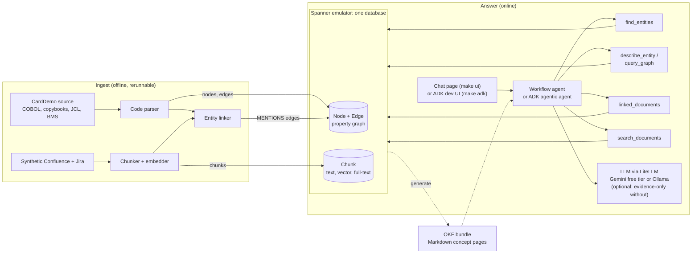
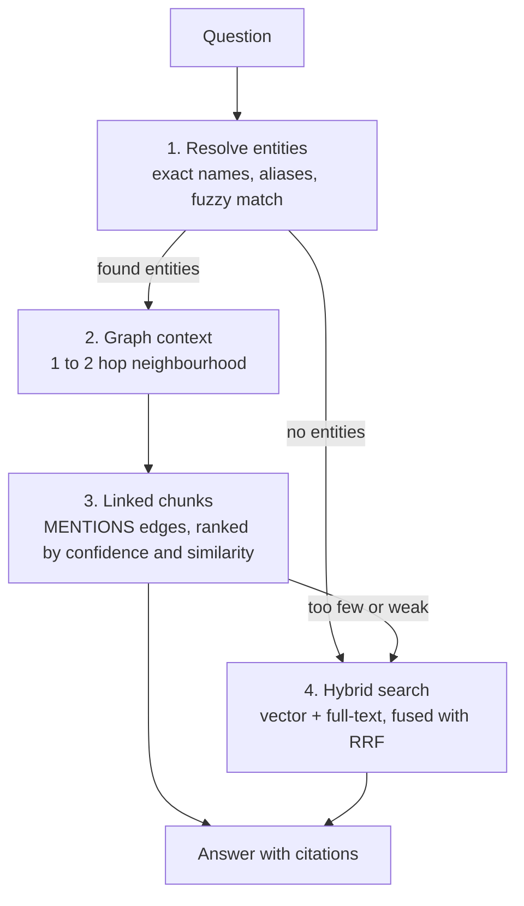

# LegacyLens architecture

LegacyLens answers questions about a mainframe codebase and the documents written
about it. It never sends the whole codebase to an LLM. Instead it builds a knowledge
store ahead of time and hands the model only the few facts a question needs. That
practice is called context engineering, and it is the point of this project.

Version 1 is question answering only. Modernization (rewriting COBOL into another
language) is out of scope until Q&A is measurably good.

## The picture



## The pieces

### 1. Corpus ([ADR-0001](adr/0001-public-corpus-only.md))

- **Code**: AWS CardDemo, an Apache-2.0 sample credit card app with about 44 COBOL
  programs, 62 copybooks, 55 JCL jobs and 21 BMS screens. It is pinned to one commit in
  `corpus/carddemo.lock` and downloaded by `scripts/fetch_corpus.py`.
- **Documents**: `corpus/docs/` holds 8 Confluence-style pages and 12 Jira-style tickets
  written for this project. They name programs exactly, by nickname ("the posting
  job"), or not at all, and one page is deliberately out of date. Each of those cases
  tests a different part of retrieval.

### 2. Knowledge store ([ADR-0002](adr/0002-spanner-emulator-single-store.md), [ADR-0003](adr/0003-graph-schema.md))

One Spanner database, running in the free local emulator, holds everything. The
schema is in [`src/legacylens/store/schema.sql`](../src/legacylens/store/schema.sql).

| Table      | Holds                                                         |
|------------|---------------------------------------------------------------|
| `Node`     | Every graph node: programs, paragraphs, copybooks, datasets, jobs, screens, transactions, business rules, and one row per document chunk |
| `Edge`     | Every relationship: `CALLS`, `XCTL`, `INCLUDES`, `READS`, `WRITES`, `RUNS`, `PERFORMS`, `DEFINES_RULE`, and `MENTIONS` (chunk to code) |
| `Document` | One row per Confluence page or Jira ticket                    |
| `Chunk`    | Chunk text, a 384-number embedding, and a full-text index     |

`LegacyGraph` is a property graph over `Node` and `Edge`. `node_type` and `edge_type`
become labels, so you can write `MATCH (j:Job)-[:RUNS]->(p:Program)`.

Node IDs are readable and stable: `PROGRAM:CBTRN02C`, `COPYBOOK:CVACT01Y`,
`DATASET:ACCTDATA`, `JOB:POSTTRAN`, `PARAGRAPH:CBACT04C.1400-COMPUTE-FEES`,
`CHUNK:JIRA:CARD-102#0`. A dataset is named by the distinctive part of its DSN, so
`AWS.M2.CARDDEMO.ACCTDATA.VSAM.KSDS` becomes `DATASET:ACCTDATA`.

`tests/test_store.py` proves the schema supports all four retrieval paths on the
emulator: graph traversal, graph-linked chunks, vector search and keyword search.

### 3. Code to graph (thread 2)

The parser turns each source file into nodes and edges. What it must extract:

| Source            | Nodes                          | Edges                                       |
|-------------------|--------------------------------|---------------------------------------------|
| COBOL program     | Program, Paragraph             | `PERFORMS`, `CALLS`, `XCTL`/`LINK`, `INCLUDES`, `READS`/`WRITES` (from `SELECT ... ASSIGN`, `OPEN` mode and CICS `READ`/`WRITE` `DATASET`) |
| Copybook          | Copybook                       | `INCLUDES` (copybook to copybook)           |
| JCL               | Job                            | `RUNS` (with step name), `READS`/`WRITES` (DD to DSN, from `DISP`) |
| BMS map           | Screen                         | `USES_SCREEN` (program to map)              |
| CICS CSD          | Transaction                    | `STARTS` (transaction to program)           |
| Business rules    | BusinessRule                   | `DEFINES_RULE` (paragraph to rule)          |
| `EXEC SQL` (Db2)  | Dataset (`kind: db2_table`)    | `READS`/`WRITES` (`SELECT`, `INSERT`, `UPDATE`, `DELETE`) |
| `EXEC DLI` (IMS)  | Dataset (`kind: ims_segment`)  | `READS` (`GU`, `GN`, `GNP`), `WRITES` (`ISRT`, `REPL`, `DLET`) |
| MQ calls          | Dataset (`kind: mq_queue`)     | `WRITES` to queues named by a literal, in programs that call `MQPUT` |

The three optional sub-applications (Db2 transaction types, IMS/Db2/MQ
authorizations, VSAM/MQ) are parsed too, and their nodes carry `props.app`. Two gaps
remain: queues a program reads come from the MQ trigger message at run time, and
batch IMS programs name segments inside `CALL 'CBLTDLI'` parameter lists, so neither
shows up as an edge yet.

Business rules start simple: the reject reason codes and `COMPUTE` statements an
extractor can see, each pointing at its source lines. LLM-written rule summaries come
later and are always marked as generated.

Two known traps: some `XCTL` targets come from data, not code (the main menu reads
them from copybook `COMEN02Y`), and many `EXEC CICS` statements span several lines.

### 4. Docs to chunks (thread 3, [ADR-0004](adr/0004-chunk-node-links.md))

1. **Chunk** by structure, not fixed size. A Confluence page splits at headings and a
   Jira ticket becomes one chunk for the description plus one per comment. Each
   chunk keeps its heading path and the document title, because "102" means nothing
   without "Reject reason codes" above it.
2. **Embed** each chunk locally with `all-MiniLM-L6-v2` (384 dimensions), run through
   ONNX Runtime. It's free, runs on a laptop CPU, needs no PyTorch, and downloads once
   (about 80 MB) from a public bucket.
3. **Link** each chunk to the code entities it talks about, as `MENTIONS` edges with a
   `method` and `confidence`:
   - `exact_name` (1.0): the text contains a known name such as `CBTRN02C`.
   - `alias` (0.8): the text contains a known nickname such as "the posting job".
     Aliases come from a small hand-kept file plus program comment headers.
   - `llm` (0.5 to 0.7): an LLM proposes links for chunks with no exact or alias hit.
     They're stored separately so their value can be measured.

This is the same idea as the chunk-to-node link table you use at work. The difference
is that here the link rows are edges in the graph, so one query can go from a job to
its programs to the documents that discuss them.

### 5. Retrieval and routing ([ADR-0005](adr/0005-graph-first-routing.md))

Every question goes through the same four steps:



- **Graph first.** If the question names a program, job, file or copybook, the graph
  gives exact facts (what calls what, which files a job touches) that vector search
  can only guess at.
- **Then linked chunks.** The graph says what the code does. The documents say why,
  what went wrong and what is planned. Only chunks linked to the resolved entities are
  candidates, so an unrelated page that happens to use similar words can't crowd out
  the right one.
- **Hybrid fallback.** Questions with no code entity, such as "what does S0C7 mean",
  go to vector search plus keyword search, merged with Reciprocal Rank Fusion.
- **Code wins conflicts.** When a document disagrees with the graph (the interest
  page says fees are computed, but the paragraph is an empty stub), the answer states
  what the code does and cites the document as out of date.

Every answer lists its evidence: node IDs with source lines and chunk IDs with titles.

### 6. Agents ([ADR-0009](adr/0009-answering-and-model-routing.md))

There are two agents, on purpose:

1. **Workflow agent** (`agents/workflow_agent.py`, the default): `graph_first()` runs
   the steps above as plain Python and the LLM only writes the final answer, from
   labelled GRAPH FACTS and DOCUMENTS sections. One model call per question.
2. **Agentic agent** (`agents/agentic_agent.py`): a Google ADK `LlmAgent` with six
   tools (`find_entities`, `describe_entity`, `query_graph`, `linked_documents`,
   `search_documents`, `read_concept`). The model decides which to call and when to
   stop.

Both follow the same rules: code beats documents, cite every claim, and say "not
found" rather than guess. `query_graph` only runs named, parameterised GQL templates
(`jobs_running`, `files_of`, `callers_of`, `programs_including` and so on), because a
template can't invent a label. Free-form text-to-GQL is a stretch goal.

The model sits behind LiteLLM, so one setting switches between Gemini's free tier and
a local Ollama model ([ADR-0006](adr/0006-models-and-cost.md)). With no model at all,
the workflow agent answers with the evidence alone. `LLM_MODEL_SMALL` turns on a
simple router that sends graph-only questions to a cheaper model.

### 7. OKF knowledge layer ([ADR-0007](adr/0007-okf-knowledge-layer.md))

`make okf` writes `knowledge/`, an Open Knowledge Format bundle with one Markdown page
per program, job, transaction, screen, copybook and dataset. Each page has YAML
frontmatter, its relationships as links to other pages, business rules and
paragraphs for programs, steps for jobs, and the documents that mention it. Agents
read it with the `read_concept` tool, people read it on GitHub, and `okf_browse` is
scored in the eval next to the other strategies.

### 8. Chat UI ([ADR-0010](adr/0010-custom-chat-page.md))

`make ui` serves a chat page at http://localhost:8000. The left side is the chat; the
right side is the evidence for the selected answer: route, entities and how they were
found, an SVG drawing of the graph neighbourhood, the facts and COBOL, and the
document chunks with their scores. Clicking an entity opens its knowledge page.
`make adk` serves the agentic agent in ADK's own dev UI, which shows every tool call.

### 9. Evaluation

`evals/questions.yaml` holds 16 seed questions, each tagged with the route that
should answer it best, the entities to resolve, checked answer facts and expected
sources. Retrieval is scored on entity recall and source recall, and answers on
whether they contain the facts. Each strategy is run on the same set: naive vector,
hybrid, graph only, graph-first with linked chunks, agentic, and OKF browse.

## Cost

Everything runs on your laptop for free: the Spanner emulator, local ONNX embeddings,
and either Ollama or Gemini's free tier. Nothing needs a Google Cloud project or a
credit card. The one limit is that the emulator keeps data in memory only, so
`make load` rebuilds the store from source in seconds after each restart.

## Where the code lives

```
src/legacylens/
  config.py          settings from environment variables
  store/             Spanner schema and connection helpers        (thread 1)
  ingest/code/       COBOL, copybook, JCL, BMS parsers           (thread 2)
  ingest/docs/       chunking, embedding, entity linking         (thread 3)
  retrieval/         graph templates, hybrid search, fusion      (threads 3-4)
  agents/            workflow and agentic agents, tools, judge   (milestone 4)
  okf/               OKF bundle generator                        (milestone 5)
  ui/                FastAPI chat page                           (milestone 6)
  evals.py           retrieval and answer scoring
adk/lens/            entry point for ADK's dev UI (make adk)
knowledge/           the generated OKF bundle (make okf)
corpus/              CardDemo lock file and synthetic documents
evals/               questions and results
docs/                this file, decision records, learning notes
```
